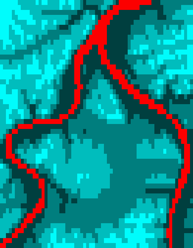
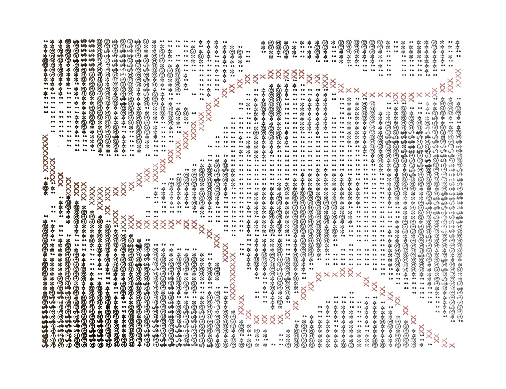

# Typewriter Map

A command-line python tool that assists in creating maps using a typewriter (artistically).


---

## Inspiration

This project was inspired by [Daniel Huffman's venture into creating maps using a typewriter](https://somethingaboutmaps.wordpress.com/2018/11/26/typewriter-cartography/). I was really inspired by his map of Africa in particular, and I liked how he was able to show elevation using different characters, and delineate coastlines and rivers using red ink. 

When I first saw his work, I had recently acquired an old, bulky typewriter from 1949, and wanted to do something similar -- namely make an elevation map of my home, Pittsburgh, Pennsylvania.

I thus wanted to create a software tool that automates the process of converting elevation maps into low-resolution pixel maps, which can then be copied onto a sheet of paper using a typewriter.

## Installation

### Quick install

With [pipx](https://pipx.pypa.io/) -- installs the command in its own isolated environment:

```bash
pipx install git+https://github.com/dreginkogan/typewriter-cartography.git
```

### From source

```bash
git clone https://github.com/dreginkogan/typewriter-cartography.git
cd typewriter-cartography

python -m venv .venv
source .venv/bin/activate

pip install .
```

For development, use `pip install -e .` instead, such that code changes take effect without reinstalling.

### Check if installation worked

```bash
typewriter-map --help
```

### Optional: tab completion

```bash
typewriter-map --install-completion
```

Restart your terminal afterward for the tool to function.

## Usage

You will need an elevation raster (DEM) saved as a TIFF file. Single-band elevation data works best, since the tool bins raw height values into a small number of levels (the default is 4). Free DEMs are available online from sources like the [USGS National Map](https://www.usgs.gov/programs/national-geospatial-program/national-map).


A basic run, using the center of the TIFF and the defaults:
```bash
typewriter-map INPUT.tif [OPTIONS]
```

Here is what I ran to generate a map of Pittsburgh.

```bash
typewriter-map cropped_allegheny.tif --output output/map_test.png --center 7500 11000 --primary-dim 15000
```

The output is a .png image where each "pixel" corresponds to a character on a typewriter. Water is displayed as red, and elevations are shown as different shades of blue-green. 

| Option | Default | Description |
|---|---|---|
| `filepath` | required | Input geographic TIFF. |
| `-o`, `--output` | `typewriter_map.png` | Output PNG path. |
| `--center ROW COL` | center of the TIFF | Center of the crop, in pixels, in numpy (row, col) order. |
| `--primary-dim` | `2000` | Crop size in pixels along the primary dimension (width for landscape crops, height for portrait). |
| `--crop-orientation` | `landscape` | Shape of the crop taken from the TIFF: `portrait` (`p`) or `landscape` (`l`). |
| `--display-orientation` | `landscape` | How the paper is oriented when the map is typed. In `landscape`, the map is typed sideways and the paper is then rotated to match. |
| `--paper-size` | `letter` | `letter` (`us`) or `a4` (`iso`). The crop matches this aspect ratio. |
| `--type-width` | `6.5` | Width in inches that the map will occupy on the page. Leave room for margins. |
| `--levels` | `4` | Number of elevation bins, i.e. how many different characters you'll use. |
| `--water-threshold` | `0.8` | Elevation value under which a pixel is treated as water. |
| `--horizontal-keys-per-inch` | `10` | How many keys per inch, horizontally, on the physical typewriter. |
| `--vertical-keys-per-inch` | `6` | How many keys per inch, vertically, on the physical typewriter. |


Run `typewriter-map --help` for the full list.

Cropping and finding the center of the crop are to be done via a process of trial and error. Since this tool is designed to be run from a command line, iterating on center coordinates can be done quickly and easily.

## Copying to a typewriter


TODO: put images of in-progress typing of a map on a typewriter.

To type my map of Pittsburgh, I used 4 levels and I used the following characters to demarcate elevations, from lowest to highest:

| Level | Character |
|---|---|
| Water | red `X` |
| Elevation 1 | space (blank) |
| Elevation 2 | `:` |
| Elevation 3 | `*` |
| Elevation 4 | `$` |


My typewritten map looks like this:


I used a 1949 Royal Typewriter, which has a ribbon switch, and a two-color black and red ribbon.

<!-- TODO: add photos of a map in-progress on my typewriter -->

## Gallery